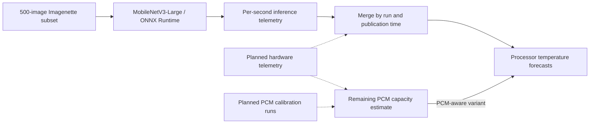

# Predictive Thermal Management for Raspberry Pi 5–Based Edge AI System

**Edge-AI workload and thermal modeling for a phase-change cooling testbed**

Sustained image inference can heat a Raspberry Pi 5 enough to trigger throttling. The senior design project tests whether a controller can make better cooling and workload decisions when it knows how much heat a phase-change material (PCM) cartridge can still absorb. This repository contains Azim’s contribution to that experiment: the inference workload, its telemetry interface, and the offline pipeline for estimating PCM capacity and comparing temperature forecasts. The team handles the cartridge, chamber, instrumentation, Pi integration, and supervisory controller separately.

[Workload](ai-workload/README.md) · [Thermal ML](ml-pipeline/README.md) · [Benchmarks](ai-workload/benchmark/README.md) · [Validation plan](part4/figures/fig5-1-test-gates.png)

## Measured on x86 Linux

| Check | Recorded result |
| --- | --- |
| Accuracy and repeatability | **82.4% top-1** (412/500) and **98.0% top-5** at 224 px. At 160 px, top-1 was **75.0%** (375/500). Repeated predictions matched at both resolutions. [Profile evaluation](ai-workload/results/x86_profile_accuracy.json) |
| Sustained inference | **160,502 inferences over 30 minutes**, averaging **89.2 FPS** at 224 px. [Run summary](ai-workload/results/SOAK_X86_HP_summary.json) · [Run metadata](ai-workload/results/SOAK_X86_HP_meta.json) |
| Candidate selection | In a separate batch-1 benchmark, MobileNetV3-Large reached **7.0 ms p95 latency** and **82.4% top-1**. ResNet50 reached **20.7 ms p95** and **83.2% top-1** on the same 500-image subset. [Five-model benchmark](ai-workload/benchmark/benchmark_results.json) |

The repository currently reports x86 software results. On-device benchmarks and thermal validation require Raspberry Pi 5 runs and PCM calibration. The thermal pipeline uses test fixtures for software checks and awaits experimental run logs for model training and evaluation.

## How the software fits together



- **Inference workload.** Runs a fixed, labeled subset of 50 images per class. It supports `high_performance` (224 px), `balanced` (160 px), and `reduced_load` (160 px with a calibrated rate). It records throughput, latency, accuracy, CPU, and memory in one-second windows. The controller interface accepts profile requests and publishes the latest quality-of-service metrics.
- **Telemetry merge.** Fills the inference fields in the experiment CSV (Table 4.4 in the SDP report). Each row uses the latest sufficiently recent AI window from the same run that had already been published at the row timestamp.
- **Thermal modeling.** Compares persistence, linear trend, XGBoost, GRU, and LSTM at 10-, 20-, and 30-second horizons. It also implements the E0 energy-balance baseline and learned E1/E2 estimators for remaining PCM capacity. The temperature-only and PCM-aware variants are scored on common forecast origins, with whole runs kept together in train, validation, and test splits.

## Quick start

Run either block independently from the repository root in Bash. The workload example uses Python 3.13, `curl`, `tar`, and the 320 px Imagenette validation split. The exported ONNX model is included in the repository.

**Run the inference verification**

```bash
(
  set -e
  cd ai-workload
  python3 -m venv .venv
  source .venv/bin/activate
  python -m pip install -r requirements-pi.txt pytest
  curl -fLO https://s3.amazonaws.com/fast-ai-imageclas/imagenette2-320.tgz
  tar -xzf imagenette2-320.tgz
  python edge_workload.py eval --data imagenette2-320/val --out profile_accuracy.json
  DATA=imagenette2-320/val python -m pytest -q tests
)
```

See the workload guide for live runs, profile calibration, and controller integration. The optional Oracle Ampere A1 script is for ARM64 software and timing checks. [Workload guide](ai-workload/README.md) · [ARM64 script](scripts/oracle-vm/run_on_vm.sh)

**Check the thermal pipeline**

```bash
(
  set -e
  cd ml-pipeline
  python3 -m venv .venv
  source .venv/bin/activate
  python -m pip install -r requirements-laptop.txt
  python -m pytest -q tests
  python -m thermalml.check_config config/pipeline_config.yaml
)
```

The config check currently lists open team settings and exits with status 1. The pipeline guide covers the required hardware logs, estimator calibration, training order, and model packaging. [Pipeline guide](ml-pipeline/README.md) · [Configuration](ml-pipeline/config/pipeline_config.yaml)

## Validation records

- **Workload:** 8 tests passed in the recorded x86 run, covering profile changes, deterministic evaluation, and telemetry merge timing. [Workload test record](ai-workload/test_record.txt)
- **Thermal pipeline:** 27 tests passed in the recorded x86 run, including end-to-end software checks with temporary test fixtures. [Pipeline test record](ml-pipeline/test_record.txt)
- **Hardware validation:** The test gates map the path from Pi bring-up and PCM calibration to a paired comparison at 35, 40, and 45 °C. M3 uses temperature-only prediction. M4 adds the PCM capacity estimate while using the same hardware, workload schedules, and available actions. [Test gates](part4/figures/fig5-1-test-gates.png) · [Milestones](part4/figures/fig5-2-milestones.png)
